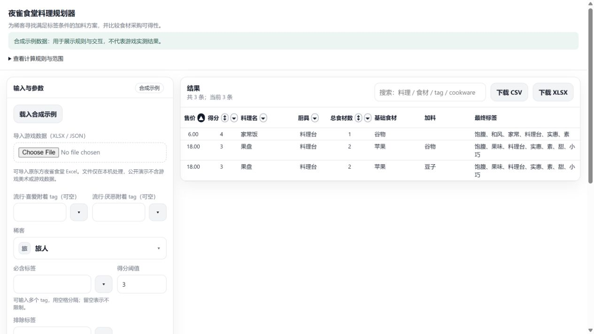

<a id="chinese"></a>

# Mystia Menu Optimizer

**夜雀食堂料理规划器：顾客偏好、食材供给与厨具约束下的组合优化**

**中文** | [English](#english)

本项目源于《东方夜雀食堂》中的备菜决策：在有限配方、五格食材限制和顾客偏好下，如何找到合格的料理，并在多种合格方案中选择更适合持续制作的一种？项目将这一问题建模为离散组合优化，以明确的规则判断可行性，以有优先级的目标比较方案，最终输出逐客料理建议与共同使用的厨具组合。

仓库提供两种本地工具：**浏览器候选查询器**用于交互探索料理与加料；**Python 批量规划器**用于求解每客方案及厨具选择。项目的设计重点是将游玩经验转化为可计算、可解释、可验证的决策模型。公开版本附带合成数据、参数对照案例和自动化检查，可独立运行。

[问题定义](#zh-problem) · [设计演进](#zh-evolution) · [数学模型](#zh-model) · [求解方法](#zh-methods) · [系统架构](#zh-architecture) · [实验验证](#zh-evaluation) · [快速开始](#zh-quickstart) · [范围与来源](#zh-scope)

<a id="zh-problem"></a>

## 1. 问题定义

料理规划包含两个不同的问题：**哪些方案符合规则，以及符合规则的方案中应该选哪一个。** 仅列出所有达标料理，仍需玩家手工权衡追加食材、供应紧张程度和厨具配置；只给出一个推荐，又难以解释它在什么条件下更优。

本项目面向具有明确喜好与厌恶标签的“稀客”。一份方案由基础料理和追加食材组成，最终标签同时受料理、厨具、售价区间、标签覆盖规则和流行状态影响。重复标签只计一次；流行由使用者指定的标签触发，附加 `流行·喜爱` 或 `流行·厌恶` 后再参与偏好判断。

| 决策层次 | 需要回答的问题 | 交付结果 |
| --- | --- | --- |
| 规则可行性 | 哪些料理与加料能达到该顾客的标签要求？ | 候选、最终标签和命中情况 |
| 逐客方案 | 达标后，如何权衡偏好覆盖、食材用量与供给压力？ | 每位顾客一套方案及其评价指标 |
| 厨具配置 | 共同使用指定数量的厨具时，能保留哪些逐客方案？ | 厨具集合、对应方案和无解顾客 |

网页侧重第一层的探索与筛选，Python 负责后两层的方案选择。网页以“喜好命中数减厌恶命中数”的净分筛选；Python 将任何厌恶命中视为不可行，因此两种工具的输出服务于不同的决策用途。

<a id="zh-evolution"></a>

## 2. 设计演进：逐步明确“最优”

最初的需求是枚举达标料理，并探索收益排序。随着备菜问题被细化，评价重点转向了三个可以直接约束方案选择的量：**满足多少喜好、消耗多少食材、最紧张的食材还剩多少供给余量。** 价格与供给记录为这些分析提供输入，最终规划主线采用以下模型演进。

| 模型 | 决策对象与目标 | 设计动因 |
| --- | --- | --- |
| 按标签多方案 | 为可覆盖的喜好标签分别选方案；先减少预期食材件数，再改善最低供给余量 | 将不同标签需求分配给多套料理，比较重复制作的资源压力 |
| 每客单方案 | 为每位顾客选一份料理；先最大化喜好覆盖，再比较件数与余量 | 将输出转成按顾客组织的备菜参考 |
| 覆盖收益封顶 | 喜好覆盖收益在 3 处封顶，之后优先减少食材件数 | 明确达标后的取舍，避免为额外喜好持续增加加料 |
| 共享厨具约束 | 在共同厨具集合下比较所有顾客的方案 | 将逐客选择扩展为设备条件一致的整体配置 |

早期多方案模型假设每客每日有 $`K`$ 单，在 $`m>0`$ 个有可行候选的标签方案之间均分。若 $`u_i`$ 为各方案中食材 $`i`$ 的累计用量，$`q_i`$ 为日供给估计，则预期食材件数与最低供给余量分别为：

```math
E_{\mathrm{old}}=\frac{K}{m}\sum_i u_i,\qquad
R_{\mathrm{old}}=\min_{i:u_i>0}\left(q_i-\frac{K}{m}u_i\right)
```

该模型先最小化预期件数，再在并列方案中最大化余量。均分订单是建模假设；没有可行标签时返回无方案。推荐单位改为顾客后，订单不再分摊到多个标签方案，当前模型直接评价一份料理重复制作的覆盖、用量与供给压力。

覆盖封顶进一步明确了选择原则。例如，A 命中三个喜好、使用两份食材，B 命中四个喜好、使用三份食材：封顶后两者的覆盖收益相同，A 因用料更少而胜出。这一规则体现工具的规划目标，也使“最优”具有可检查的含义。完整推导与设计记录见[数学建模说明](docs/design.md)和[需求演进复盘](docs/prompt-journey.md)。

<a id="zh-model"></a>

## 3. 当前数学模型

### 3.1 变量与可行域

对顾客 $`g`$，方案 $`p=(d,x)`$ 包含一道基础料理 $`d`$ 和整数加料向量 $`x`$。令 $`b_i(d)`$ 为基础配方中食材 $`i`$ 的件数，则总用量满足：

```math
c_i(p)=b_i(d)+x_i,\qquad x_i\in\mathbb{Z}_{\ge0},\qquad
L(p)=\sum_i c_i(p)\le5
```

可行候选集 $`\mathcal{F}_g`$ 由已拥有料理、可用厨具及以下规则共同确定：

| 规则 | 模型中的处理 |
| --- | --- |
| 基础配方 | 计入食材件数与五格限制；基础食材的标签不再次叠加 |
| 追加食材 | 允许重复，每份均占格；标签按集合去重 |
| 五格附加标签 | 有追加食材且总件数达到 5 时，加入“大份” |
| 配方禁忌 | 禁用名称与禁用标签约束追加食材 |
| 标签计算 | 合并料理、厨具、售价派生与加料标签；处理覆盖关系；最后检测流行附着 |
| 覆盖关系 | 肉覆盖素、饱腹覆盖下酒、重油覆盖清淡、大份覆盖小巧 |
| 顾客准入 | 最终不命中任何厌恶标签，喜好命中数达到最低分门槛 |

### 3.2 单客目标：覆盖、用量、余量

设 $`h_g(p)`$ 为喜好命中数，$`q_i`$ 为食材日供给估计，$`K`$ 为该顾客的假设日订单量。重复制作方案后的最低供给余量定义为：

```math
R(p)=\min_{i:c_i(p)>0}\left(q_i-Kc_i(p)\right)
```

规划器按以下词典序目标选择方案：

```math
\max_{p\in\mathcal{F}_g}^{\mathrm{lex}}
\left(\min(h_g(p),3),\;-L(p),\;R(p)\right)
```

**词典序意味着前一项相同，才比较后一项。** 覆盖收益优先，其次减少食材件数，最后改善最低余量；覆盖收益相同时，较高余量不能抵消多用一份食材。三项相同时，再按售价和名称等固定次序处理平局。

默认最低分为 `3`，每客假设日订单量为 `K=5`。最低分决定准入，覆盖上限决定收益：最低分可配置，覆盖上限固定为 3。食材件数衡量用量，余量衡量逐客供给压力；余量允许为负，不作为库存硬约束。

### 3.3 厨具集合选择

令 $`H`$ 为已拥有料理对应、并排除指定厨具后的可用集合，规划器枚举满足 $`S\subseteq H,\;|S|=n`$ 的集合。对每个集合，汇总其能够提供的逐客最优方案，依次最大化封顶覆盖总和、最小化食材件数总和、最大化个体余量总和。每位无解顾客的覆盖计为 0，另计入 $`10^9`$ 的件数惩罚与 $`10^{18}`$ 的余量扣减；完整表达见[厨具目标定义](docs/design.md#数学建模从历史多方案到当前单方案)。

默认三分门槛下，每个可行方案的覆盖收益均为 3，因此首先争取让更多顾客有方案。若降低门槛，首要指标变为覆盖总量，不能等同于有解人数。厨具数量是**恰好 n 种**，可能包含最终方案未使用的厨具。共同厨具限制统一了设备条件；食材余量仍逐客计算，各顾客没有共同扣减库存。

<a id="zh-methods"></a>

## 4. 求解方法与 CPU 计算

项目面向普通 CPU 环境，不依赖 GPU。目标确定后，主要计算难点来自加料组合、同标签食材替代和厨具集合枚举。当前 Python 采用分层组合搜索，将规则判断与具体食材分配分开处理。

| 步骤 | 当前 Python 方法 | 作用 |
| --- | --- | --- |
| 1. 组织候选 | 合法加料按完全相同的标签集合分组，在五格限制内按加料件数逐层枚举组多重集 | 合并重复的标签计算，保留重复加料的可能性 |
| 2. 提前排除 | 检查不可消除的厌恶、乐观喜好上界与当前最佳件数界限 | 跳过无法改善目标的分支 |
| 3. 分配具体食材 | 固定标签组用量后，用离散余量阈值的容量判定与二分搜索选择组内成员，计入基础配方耗用 | 在标签效果相同的候选中比较供给差异 |
| 4. 完成逐客比较 | 对每道料理，完整比较首次取得封顶覆盖的加料件数层，再停止该料理更长层；继续比较其他料理，保留每客每厨具最佳方案 | 保留余量与平局处理所需的候选 |
| 5. 比较厨具集合 | 复用逐客逐厨具结果，枚举指定数量的厨具组合 | 避免对每个集合重新搜索全部料理 |

历史多方案模型采用过另一种阈值求解：将“最大化最低余量”改写为“能否达到余量下界 $`\lambda`$”，利用可行性的单调性进行二分，内部通过深度优先搜索、容量剪枝与状态缓存判定。它对应多个标签方案的联合选择；当前的容量阈值二分用于固定标签组内的食材分配，两者处理的子问题不同。

网页按料理分块，最多使用 8 个 CPU Web Worker，并分批返回结果、报告进度和支持停止。加料子集过滤、高级食材替代与等价去重作为可选筛选策略保留：替代必须满足完整方案的合法性，部分策略还需比较得分。筛选选项表达使用者对候选的保留偏好，会改变展示集合；供给差异由相应推荐逻辑另行比较。

<a id="zh-architecture"></a>

## 5. 系统架构

系统包含两条独立的本地执行路径，共用输入数据约定，彼此没有 API 调用。

```text
XLSX / JSON ──→ 浏览器解析 ──→ Web Workers ──→ 候选筛选 ──→ CSV / XLSX
XLSX ──→ prepare_data.py ──→ 标准 JSON ──→ Python 规划器 ──→ JSON / CSV
```

| 模块 | 入口 | 职责 |
| --- | --- | --- |
| 交互查询 | [index.html](index.html)、[web/app.js](web/app.js) | 文件读取、参数配置、并行枚举、筛选与导出 |
| 数据准备 | [tools/prepare_data.py](tools/prepare_data.py) | 工作簿转 JSON、按名称关联商贩均价、生成导入审计 |
| 规则与规划 | [src/mystia_planner/](src/mystia_planner/) | 数据对象、标签规则、组合搜索、厨具比较与 CLI |
| 复现与检查 | [data/](data/)、[examples/](examples/)、[tests/](tests/) | 合成输入、案例输出和回归验证 |

文件在本地处理，无需账户或计算后端。运行单元、组件依赖和数据流的详细视图见[架构说明](docs/architecture.md)。

<a id="zh-evaluation"></a>

## 6. 可复现实验与验证

公开实验使用 **12 种食材、8 道料理和 3 位虚构顾客**。数据为演示规则而构造，用于检查参数变化能否产生可解释的方案变化。四组案例均以最低分 3 为基础；除表中变量外，保持其他条件一致。

| 案例 | 条件变化 | 有解顾客 | 代表料理总件数 | 观察结果 |
| --- | --- | --- | --- | --- |
| 基线 | `K=5`，3 种厨具，无流行 | 3/3 | 4 | 旅人、茶客、匠人的最低余量分别为 31、21、9 |
| 厨具收缩 | 厨具数量改为 1 | 2/3 | 3 | 选择料理台；匠人无可行方案 |
| 需求增加 | `K` 改为 15 | 3/3 | 4 | 原方案不变，最低余量降为 21、11、−1 |
| 流行变化 | “下酒”触发流行厌恶 | 3/3 | 5 | 匠人改用烤串＋谷物，利用饱腹覆盖下酒，避免触发流行厌恶 |

“代表料理总件数”统计每位有解顾客的一份推荐，不乘日订单量。需求增加案例中的负余量使供给压力显式可见；流行案例则检验标签覆盖与流行判断的执行顺序。完整输入、逐客输出与解释见[案例分析](docs/case-study.md)。



实现验证包含 **31 项 Python 测试和 11 项网页测试**。Python 测试包含 90 组固定种子小输入，与独立的具体食材穷举结果比较；网页测试执行实际 Worker，覆盖禁忌、停止计算、零阈值和空筛选导出等边界。

另以本地真实数据完成了 58 位顾客的默认参数规划与逐条规则复核，作为数据兼容性检查。公开复现以合成数据为准；真实输入未随仓库分发。检查方法与既有结果见[验证记录](docs/verification.md)，持续集成运行见 [GitHub Actions](https://github.com/Mingcode123/Mystia-Menu-Optimizer/actions)。

<a id="zh-quickstart"></a>

## 7. 快速开始与复现

### 网页查询

下载仓库，保持目录结构，在仓库根目录启动本地 HTTP 服务：

```sh
python -m http.server 8000 --bind 127.0.0.1
```

访问 <http://127.0.0.1:8000>，合成样例会自动载入。选择顾客并点击“开始计算”，即可查看候选并调整筛选条件。界面、示例标签和详细文档目前使用中文；操作与导出说明见[网页指南](docs/web-guide.md)。

### Python 规划

需要 Python 3.10 或更新版本。JSON 规划与合成案例仅使用标准库。

```sh
# 重建四组实验结果
python tools/reproduce_examples.py

# 使用合成数据生成规划报告
python tools/run_planner.py --input data/demo.json --cookware-count 3 --output outputs/my-plan.json

# 查看顾客、流行、厨具、最低分和订单量参数
python tools/run_planner.py --help
```

### 导入自有数据

网页可直接读取 XLSX 或标准 JSON。为 Python 准备工作簿数据时，安装导入依赖后执行：

```sh
python -m pip install -r requirements.txt
python tools/prepare_data.py my-workbook.xlsx --output local-data/game-data.json --report local-data/import-report.json
python tools/run_planner.py --input local-data/game-data.json --cookware-count 3 --output outputs/game-plan.json
```

工作簿需包含 `食材`、`料理`、`稀客`、`食材merchant_data` 四张表；表头和字段对应见[工作簿结构](docs/data-provenance.md#workbook-schema)，JSON 样例见 [demo.json](data/demo.json)。导入器读取 Excel 缓存值，按名称关联平均进价，未知价格保留 `null`，原工作簿不被改写。`local-data/` 与 `outputs/` 已列入忽略规则。

### 运行检查

```sh
python tools/run_checks.py
node --test tests/web-regression.cjs
```

Node.js 仅用于网页测试；工作簿导入检查需要前述 Python 依赖。

<a id="zh-scope"></a>

## 8. 适用范围与局限

本项目求解输入数据和既定规则下的料理组合选择。当前未联合建模酒水、完整满意度、现金利润、实际订单概率或跨顾客共享库存；预算仅作展示。供给输入是经验估计，缺少完整原始采样记录，因此这些输出用于比较备菜方案，不构成整晚经营收益或可供给性的保证。

小规模穷举对照支持已覆盖输入范围内的实现正确性；尚未建立跨设备性能基准，也未以实测游戏收益评估策略效果。后续可在保留当前可解释目标的基础上，加入共同库存约束、订单分布与性能基准。

## 9. 作者贡献与数据来源

| 工作 | 贡献与归属 |
| --- | --- |
| 问题与模型设计 | 作者定义游玩问题、规则语义、筛选条件、目标优先级和厨具约束，并通过具体角色案例验收 |
| 经验数据整理 | 作者在游戏中手工记录价格、日供给及委托相关数据，整理经验期望 |
| 求解策略迭代 | 作者提出 CPU 计算效率与结果一致性要求，参与方案取舍和案例核验；具体算法推导与实现采用 AI 辅助 |
| 原型实现 | 大量代码实现与部分调试采用 AI 辅助，作者持续核对规则与结果 |
| 公开版本整理 | 在 AI 协助下完成模块化、合成案例、来源审计、回归检查、已记录修复与文档 |
| 历史标签来源 | [AnYiEE/touhou-mystia-izakaya-assistant](https://github.com/AnYiEE/touhou-mystia-izakaya-assistant) |

公开包使用合成数据，不附游戏美术、完整游戏数据库或原始聊天。数据字段与期望口径见[数据来源说明](docs/data-provenance.md)，整理变更见 [CHANGELOG](CHANGELOG.md)。SheetJS CE 0.20.3 随附其许可；本项目代码尚未单独选定开源许可证，详见[第三方与许可说明](THIRD_PARTY_NOTICES.md)。本项目是《东方夜雀食堂》的非官方个人工具。

---

<a id="english"></a>

# Mystia Menu Optimizer

**Combinatorial meal planning under guest preferences, ingredient supply, and cookware constraints**

[中文](#chinese) | **English**

This project addresses a meal preparation problem in *Touhou Mystia's Izakaya*: finding qualifying dishes under available recipes, a five-ingredient limit, and guest preferences, then selecting a plan suited to repeated preparation. It formulates the task as discrete combinatorial optimization, using explicit rules to determine feasibility and ordered objectives to compare alternatives. The output consists of per-guest dish recommendations and a shared cookware set.

The repository provides two local tools: a **browser candidate explorer** for interactive dish and added-ingredient queries, and a **Python batch planner** for selecting guest plans and cookware. The design centers on translating gameplay experience into a computable, explainable, and verifiable decision model. The public version includes synthetic data, controlled parameter comparisons, and automated checks, and can run independently.

[Problem definition](#en-problem) · [Design evolution](#en-evolution) · [Mathematical model](#en-model) · [Solution methods](#en-methods) · [Architecture](#en-architecture) · [Evaluation](#en-evaluation) · [Quick start](#en-quickstart) · [Scope and sources](#en-scope)

<a id="en-problem"></a>

## 1. Problem definition

Meal planning involves two distinct questions: **which plans satisfy the rules, and which feasible plan should be selected.** Enumerating every qualifying dish still leaves the player to weigh added ingredients, supply pressure, and cookware choices. A recommendation alone, meanwhile, gives little explanation of the conditions under which it is preferable.

The project focuses on rare guests (`稀客`) with explicit liked and disliked tags. Each plan combines a base dish with added ingredients. Its final tags depend on the dish, cookware, selling-price range, tag overrides, and trends. Duplicate tags count once. Trends are triggered by user-specified tags, adding `流行·喜爱` or `流行·厌恶` before guest preferences are evaluated.

| Decision level | Question | Output |
| --- | --- | --- |
| Rule feasibility | Which dishes and additions meet the guest's tag requirements? | Candidates, final tags, and preference matches |
| Per-guest planning | Once requirements are met, how should preference coverage, ingredient use, and supply pressure be balanced? | One plan per guest with evaluation metrics |
| Cookware configuration | Which guest plans remain available under a shared set of a specified number of cookware types? | Cookware set, corresponding plans, and guests with no feasible plan |

The browser supports exploration and filtering at the first level; Python selects plans at the other two levels. The browser filters by the net score of liked tags minus disliked tags, while Python treats any disliked tag as infeasible. Their outputs therefore serve different decision purposes.

<a id="en-evolution"></a>

## 2. Design evolution: defining “optimal”

The initial requirement was to enumerate qualifying dishes and explore rankings by economic return. As the preparation problem became more specific, evaluation shifted toward three quantities that could directly guide plan selection: **how many preferences are satisfied, how many ingredient units are consumed, and how much supply slack remains for the most constrained ingredient.** Price and supply records provided inputs for this analysis. The main planning model evolved as follows.

| Model | Decision object and objective | Design rationale |
| --- | --- | --- |
| Multiple plans by tag | Select a plan for each coverable liked tag; first reduce expected ingredient units, then improve minimum supply slack | Allocate tag-specific demand across several dishes and compare the resource pressure of repeated preparation |
| One plan per guest | Select one dish per guest; first maximize preference coverage, then compare ingredient units and slack | Organize the preparation reference by guest |
| Capped coverage benefit | Cap preference coverage benefit at 3, then prioritize fewer ingredient units | Make the tradeoff after qualification explicit, avoiding further additions solely for extra preferences |
| Shared cookware constraint | Compare all guest plans under a common cookware set | Extend per-guest choices into a joint configuration with consistent equipment conditions |

The early multiple-plan model assumed $`K`$ daily orders per guest, divided equally among $`m>0`$ tag-specific plans with feasible candidates. If $`u_i`$ is the total use of ingredient $`i`$ across these plans and $`q_i`$ its estimated daily supply, expected ingredient units and minimum supply slack are:

```math
E_{\mathrm{old}}=\frac{K}{m}\sum_i u_i,\qquad
R_{\mathrm{old}}=\min_{i:u_i>0}\left(q_i-\frac{K}{m}u_i\right)
```

The model first minimizes expected ingredient units, then maximizes slack among tied solutions. Equal allocation of orders is a modeling assumption; if no tag is feasible, no plan is returned. Once the recommendation unit becomes the guest, orders are no longer divided among several tag-specific plans. The current model directly evaluates coverage, usage, and supply pressure when one dish is prepared repeatedly.

Capping coverage further specifies the selection principle. Suppose A matches three liked tags using two ingredient units, while B matches four using three units. After capping, their coverage benefit is equal, and A wins because it uses fewer ingredients. This rule expresses the tool's planning objective and makes “optimal” verifiable. Full derivations and design records are available in the [mathematical model notes (Chinese)](docs/design.md) and [requirements retrospective (Chinese)](docs/prompt-journey.md).

<a id="en-model"></a>

## 3. Current mathematical model

### 3.1 Variables and feasible set

For guest $`g`$, a plan $`p=(d,x)`$ consists of a base dish $`d`$ and an integer vector of added ingredients $`x`$. Let $`b_i(d)`$ be the number of units of ingredient $`i`$ in the base recipe. Total usage satisfies:

```math
c_i(p)=b_i(d)+x_i,\qquad x_i\in\mathbb{Z}_{\ge0},\qquad
L(p)=\sum_i c_i(p)\le5
```

The feasible candidate set $`\mathcal{F}_g`$ is determined by owned recipes, available cookware, and the following rules:

| Rule | Treatment in the model |
| --- | --- |
| Base recipe | Counts toward ingredient units and the five-slot limit; base-ingredient tags are not added again |
| Added ingredients | Repetition is allowed, with each unit occupying a slot; tags are deduplicated as a set |
| Five-slot tag | Add `大份` when the plan includes added ingredients and reaches five ingredient units in total |
| Recipe restrictions | Forbidden ingredient names and tags constrain additions |
| Tag calculation | Combine dish, cookware, selling-price-derived, and added-ingredient tags; apply overrides; then check trend attachment |
| Overrides | `肉` overrides `素`; `饱腹` overrides `下酒`; `重油` overrides `清淡`; `大份` overrides `小巧` |
| Guest eligibility | Final tags match no dislikes, and the number of liked tags meets the minimum score threshold |

### 3.2 Per-guest objective: coverage, usage, and slack

Let $`h_g(p)`$ be the number of liked tags matched, $`q_i`$ estimated daily ingredient supply, and $`K`$ the guest's assumed daily order volume. Minimum supply slack after repeated preparation is defined as:

```math
R(p)=\min_{i:c_i(p)>0}\left(q_i-Kc_i(p)\right)
```

The planner selects a plan using the following lexicographic objective:

```math
\max_{p\in\mathcal{F}_g}^{\mathrm{lex}}
\left(\min(h_g(p),3),\;-L(p),\;R(p)\right)
```

**Lexicographic order compares a later criterion only when the preceding one is tied.** Coverage benefit comes first, followed by fewer ingredient units, then greater minimum slack. At equal coverage benefit, higher slack cannot compensate for using an extra ingredient unit. When all three criteria tie, selling price, name, and other fixed ordering rules determine the result.

The defaults are a minimum score of `3` and an assumed daily order volume of `K=5` per guest. The minimum score determines eligibility; the coverage cap determines benefit. The former is configurable, while the latter is fixed at 3. Ingredient units measure usage, and slack measures supply pressure per guest. Slack may be negative and is not a hard inventory constraint.

### 3.3 Cookware set selection

Let $`H`$ be the set of available cookware types associated with owned recipes, after removing specified exclusions. The planner enumerates sets satisfying $`S\subseteq H,\;|S|=n`$. For each set, it aggregates the best available plan for each guest, then maximizes total capped coverage, minimizes total ingredient units, and maximizes the sum of individual supply slack values, in that order. Each guest with no feasible plan contributes zero coverage, a penalty of $`10^9`$ ingredient units, and a deduction of $`10^{18}`$ from total slack. See the [cookware objective definition (Chinese)](docs/design.md#数学建模从历史多方案到当前单方案) for the full formulation.

At the default three-point threshold, each feasible plan has a coverage benefit of 3, so the first priority is to give more guests a feasible plan. With a lower threshold, the primary metric becomes total coverage and no longer equals the number of guests covered. The cookware count is **exactly n types**, which may include cookware unused by the final plans. Shared cookware imposes common equipment conditions; ingredient slack remains a per-guest metric, with no shared inventory deducted across guests.

<a id="en-methods"></a>

## 4. Solution methods and CPU computation

The project targets conventional CPU environments and does not require a GPU. Once the objectives are defined, the main computational challenges are added-ingredient combinations, substitutions among ingredients with identical tags, and cookware set enumeration. The current Python implementation uses layered combinatorial search, separating rule evaluation from allocation of specific ingredients.

| Step | Current Python method | Purpose |
| --- | --- | --- |
| 1. Organize candidates | Group legal additions by identical tag sets; enumerate multisets of groups in layers by added-ingredient count, within the five-slot limit | Consolidate repeated tag calculations while retaining repeated additions |
| 2. Prune early | Check unavoidable dislikes, an optimistic upper bound on liked tags, and the current best ingredient-count bound | Skip branches that cannot improve the objective |
| 3. Allocate specific ingredients | With group quantities fixed, use capacity feasibility checks and binary search over discrete slack thresholds to select group members, accounting for base-recipe consumption | Compare supply differences among candidates with identical tag effects |
| 4. Complete per-guest comparison | For each dish, fully compare the first layer that reaches the coverage cap, then stop layers with more added ingredients for that dish; continue comparing other dishes and retain the best plan for each guest and cookware type | Preserve candidates needed for slack comparison and tie-breaking |
| 5. Compare cookware sets | Reuse per-guest, per-cookware results while enumerating combinations of the specified size | Avoid searching all dishes again for each cookware set |

The historical multiple-plan model used a different threshold formulation: rewriting “maximize minimum slack” as “can slack reach a lower bound $`\lambda`$?” and using monotone feasibility for binary search. Its internal check used depth-first search, capacity pruning, and state caching. That formulation jointly selected several tag-specific plans; the current capacity-threshold search allocates ingredients within fixed tag groups. They solve different subproblems.

The browser partitions work by dish across up to eight CPU Web Workers, returning results in batches, reporting progress, and supporting cancellation. Added-ingredient subset filtering, higher-grade ingredient replacement, and equivalent-ingredient deduplication remain optional strategies. Replacements must satisfy the legality of the complete plan, and some strategies also compare scores. These options express which candidates the user wants to retain and change the displayed set; supply differences are evaluated separately by the relevant recommendation logic.

<a id="en-architecture"></a>

## 5. System architecture

The system has two independent local execution paths that share an input data convention. There are no API calls between them.

```text
XLSX / JSON ──→ Browser parsing ──→ Web Workers ──→ Candidate filtering ──→ CSV / XLSX
XLSX ──→ prepare_data.py ──→ Standard JSON ──→ Python planner ──→ JSON / CSV
```

| Module | Entry points | Responsibilities |
| --- | --- | --- |
| Interactive queries | [index.html](index.html), [web/app.js](web/app.js) | File loading, parameter configuration, parallel enumeration, filtering, and export |
| Data preparation | [tools/prepare_data.py](tools/prepare_data.py) | Convert workbooks to JSON, associate average purchase prices from merchants by name, and generate an import audit |
| Rules and planning | [src/mystia_planner/](src/mystia_planner/) | Data objects, tag rules, combinatorial search, cookware comparison, and CLI |
| Reproduction and checks | [data/](data/), [examples/](examples/), [tests/](tests/) | Synthetic inputs, case outputs, and regression verification |

Files are processed locally, with no account or computation backend required. The [architecture notes (Chinese)](docs/architecture.md) provide detailed views of runtime units, component dependencies, and data flow.

<a id="en-evaluation"></a>

## 6. Reproducible experiments and verification

The public experiments use **12 ingredients, eight dishes, and three fictional guests**. The data was constructed to demonstrate rules and test whether parameter changes produce explainable changes in plans. All four cases use a minimum score of 3; conditions remain fixed except for the variable listed in the table.

| Case | Condition change | Guests with a plan | Total units across representative dishes | Observation |
| --- | --- | --- | --- | --- |
| Baseline | `K=5`, three cookware types, no trends | 3/3 | 4 | Minimum slack for `旅人`, `茶客`, and `匠人` is 31, 21, and 9, respectively |
| Reduced cookware | Set cookware count to 1 | 2/3 | 3 | Select `料理台`; `匠人` has no feasible plan |
| Increased demand | Set `K` to 15 | 3/3 | 4 | Plans remain unchanged; minimum slack falls to 21, 11, and −1 |
| Changed trend | `下酒` triggers the disliked trend | 3/3 | 5 | `匠人` switches to `烤串` + `谷物`; `饱腹` overrides `下酒`, preventing the disliked trend from triggering |

“Total units across representative dishes” counts one recommended dish for each guest with a feasible plan, without multiplying by daily order volume. Negative slack in the increased-demand case exposes supply pressure. The trend case tests the order of tag overrides and trend evaluation. Full inputs, per-guest outputs, and explanations are provided in the [case analysis (Chinese)](docs/case-study.md).


Implementation verification includes **31 Python tests and 11 web tests**. The Python tests compare 90 fixed-seed small inputs against an independent exhaustive search over specific ingredients. The web tests execute the actual Worker and cover edge cases including ingredient restrictions, cancellation, a zero threshold, and export with an empty filtered result.

Default-parameter planning and a rule-by-rule review were also completed locally for 58 guests using real game data as a compatibility check. Public reproduction uses synthetic data; the real inputs are not distributed with the repository. See the [verification record (Chinese)](docs/verification.md) for methods and recorded results, and [GitHub Actions](https://github.com/Mingcode123/Mystia-Menu-Optimizer/actions) for continuous integration runs.

<a id="en-quickstart"></a>

## 7. Quick start and reproduction

### Browser queries

Download the repository, preserve its directory structure, and start a local HTTP server from the repository root:

```sh
python -m http.server 8000 --bind 127.0.0.1
```

Visit <http://127.0.0.1:8000>; the synthetic sample loads automatically. Select a guest and click `开始计算` (start calculation) to view candidates and adjust filters. The interface, sample tags, and detailed documentation currently use Chinese. See the [web guide (Chinese)](docs/web-guide.md) for operation and export instructions.

### Python planning

Python 3.10 or later is required. JSON planning and the synthetic cases use only the standard library.

```sh
# Rebuild the four experimental results
python tools/reproduce_examples.py

# Generate a planning report from synthetic data
python tools/run_planner.py --input data/demo.json --cookware-count 3 --output outputs/my-plan.json

# View parameters for guests, trends, cookware, minimum score, and order volume
python tools/run_planner.py --help
```

### Import your own data

The browser reads XLSX or standard JSON directly. To prepare workbook data for Python, install the import dependencies and run:

```sh
python -m pip install -r requirements.txt
python tools/prepare_data.py my-workbook.xlsx --output local-data/game-data.json --report local-data/import-report.json
python tools/run_planner.py --input local-data/game-data.json --cookware-count 3 --output outputs/game-plan.json
```

The workbook must contain four sheets named `食材`, `料理`, `稀客`, and `食材merchant_data`. See the [workbook schema (Chinese)](docs/data-provenance.md#workbook-schema) for headers and field mappings, and [demo.json](data/demo.json) for a JSON example. The importer reads Excel's cached values, associates average purchase prices by name, retains `null` for unknown prices, and leaves the source workbook unchanged. `local-data/` and `outputs/` are covered by ignore rules.

### Run checks

```sh
python tools/run_checks.py
node --test tests/web-regression.cjs
```

Node.js is used only for web tests. Workbook import checks require the Python dependencies above.

<a id="en-scope"></a>

## 8. Scope and limitations

The project selects dish combinations under the supplied data and defined rules. It does not currently model drinks, complete satisfaction, cash profit, actual order probabilities, or shared inventory across guests as a joint optimization problem. Budget is displayed only. Supply inputs are empirical estimates without complete original sampling records. The outputs support comparisons of preparation plans and do not guarantee returns or sufficient supply for an entire evening.

Small-scale exhaustive comparisons support implementation correctness within the covered inputs. Cross-device performance benchmarks have not yet been established, and strategy effectiveness has not been evaluated through measured in-game returns. Future extensions could add shared inventory constraints, order distributions, and performance benchmarks while retaining the current interpretable objectives.

## 9. Author contributions and data sources

| Work | Contribution and attribution |
| --- | --- |
| Problem and model design | The author defined the gameplay problem, rule semantics, filtering conditions, objective priorities, and cookware constraints, and validated results through specific character cases |
| Empirical data preparation | The author manually recorded in-game prices, daily supply, and commission-related data, and compiled empirical expectations |
| Solver strategy iteration | The author set requirements for CPU efficiency and result consistency, participated in design tradeoffs, and checked cases; specific algorithm derivations and implementation were AI-assisted |
| Prototype implementation | A substantial portion of implementation and some debugging were AI-assisted, with ongoing author checks of rules and results |
| Public version preparation | Modularization, synthetic cases, source auditing, regression checks, documented fixes, and documentation were completed with AI assistance |
| Historical tag source | [AnYiEE/touhou-mystia-izakaya-assistant](https://github.com/AnYiEE/touhou-mystia-izakaya-assistant) |

The public package uses synthetic data and does not include game art, the complete game database, or original chat logs. See the [data provenance notes (Chinese)](docs/data-provenance.md) for fields and expectation definitions, and the [changelog (Chinese)](CHANGELOG.md) for preparation changes. SheetJS CE 0.20.3 is bundled with its license. An open-source license has not yet been selected separately for this project's own code; see the [third-party and licensing notes (Chinese)](THIRD_PARTY_NOTICES.md). This is an unofficial personal tool for *Touhou Mystia's Izakaya*.
