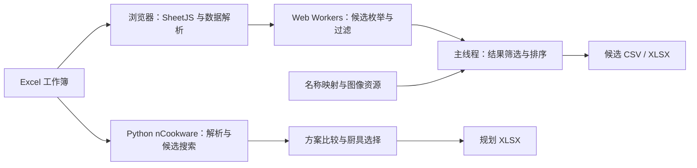

# 系统架构与执行流程

本文依据仓库源码说明运行边界、文件职责与数据流。评价目标和搜索约束见[模型与算法](design.md)，参数与输出格式见[输入输出说明](input-output.md)。

## 系统边界

系统采用工作簿驱动的结构，包括浏览器查询和 Python 分析两类独立入口。两者共享 Excel 数据格式，各自完成解析、计算和输出；入口之间没有调用关系。网页由 GitHub Pages 或本地静态 HTTP 服务提供文件，候选搜索在浏览器 CPU 上执行，无需计算服务器。

仓库根目录提供当前实现。[v1.0.0 Release](https://github.com/Mingcode123/Mystia-Menu-Optimizer/releases/tag/v1.0.0) 保存优化前基准版，可查看对应源码并下载包含程序、工作簿、网页依赖、Python 依赖清单、图像和当时说明文档的完整项目。以下执行流程与文件统计针对当前版本。

下图展示网页查询与 `nCookware` 批量规划的主要数据流。其他 PLAN 分支、评分、利润和交互菜单由独立脚本提供。

## 文件与职责

| 文件或目录 | 职责 |
| --- | --- |
| [index.html](../index.html) | 页面结构与样式、主线程逻辑、数据解析、Worker 脚本、筛选与导出 |
| [HTML/xlsx.full.min.js](../HTML/xlsx.full.min.js) | SheetJS 依赖，用于读取与写出工作簿 |
| [HTML/icon_map.js](../HTML/icon_map.js)、[HTML/izakaya_icons_pack/](../HTML/izakaya_icons_pack/) | 根据名称匹配稀客头像和料理图片 |
| [东方夜雀食堂.xlsx](../东方夜雀食堂.xlsx) | 13 张工作表组成的数据文件，包含公式及其已保存结果 |
| [Python/](../Python/) | 规划、评分、利润与交互菜单脚本，以及菜单使用的数据类，共 11 个文件 |
| [data/workbook-provenance.json](../data/workbook-provenance.json) | 工作簿来源、文件哈希及复制一致性记录 |

网页采用单 HTML 文件组织方式：样式、主线程代码和 Worker 源码字符串均位于 `index.html`。图中的解析、搜索、筛选和导出表示逻辑职责，其物理实现集中在该文件内。`HTML/` 目录提供独立依赖与图像资源。

## 网页执行

1. 页面请求同目录的 `东方夜雀食堂.xlsx`，或读取文件选择器指定的 XLSX。
2. SheetJS 读取单元格，解析函数构建食材、料理、稀客与供给数据。
3. 主线程接收角色与筛选条件，按料理划分任务，创建最多 8 个 Web Worker。
4. Worker 预编译标签位集，枚举追加食材并完成规则判断，为通过条件的组合构造候选，分批返回结果与进度。
5. 主线程按原任务分块顺序合并结果，维护搜索条件和排序状态，输出 CSV 或含 `结果` 工作表的 XLSX。

Worker 由脚本字符串和 Blob URL 创建，通过浏览器内部消息传递任务、进度与候选。料理采用静态分块，线程数量依据硬件并发数和料理数确定，上限为 8；主线程合并顺序与 Worker 完成先后无关。

每次计算先将规范化标签映射到位编号，并以 `Uint32Array` 保存多个 32 位字。并集、覆盖删除、条件交集和命中计数在位集上执行，处理顺序保持为覆盖规则、流行喜爱附加、流行厌恶附加、必含／排除条件与得分门槛。只有通过条件的组合才构造食材名称数组、标签集合和后续过滤所需的计数键；最终标签按原插入顺序重建，再使用相同中文排序规则输出。位集长度随标签规模扩展，不限制为 32 或 64 个标签。

结果搜索将每行的搜索文本缓存在 `WeakMap` 中，重复查询复用该文本；缓存独立于导出对象。“停止”直接终止当前 Worker，并更新运行标识，使已排队的旧任务消息失效。取消后恢复计算按钮，不将尚未完成的局部结果发布为完整结果。

<strong>v1.0.0 · Initial Release — 网页执行完整原文</strong>

以下完整保留 [v1.0.0 原文](https://github.com/Mingcode123/Mystia-Menu-Optimizer/blob/v1.0.0/docs/architecture.md)；其中的实现说明与验证范围均对应该版本。

## 网页执行

1. 页面请求同目录的 `东方夜雀食堂.xlsx`，或读取文件选择器指定的 XLSX。
2. SheetJS 读取单元格，解析函数构建食材、料理、稀客与供给数据。
3. 主线程接收角色与筛选条件，按料理划分任务，创建最多 8 个 Web Worker。
4. Worker 枚举追加食材，计算最终标签并执行候选过滤，分批返回结果与进度。
5. 主线程维护结果集合、搜索条件和排序状态，输出 CSV 或含 `结果` 工作表的 XLSX。

Worker 由脚本字符串和 Blob URL 创建，通过浏览器内部消息传递任务、进度与候选。“停止”操作同样采用消息机制；Worker 执行同步搜索时，停止请求可能延后处理。

角色与料理图像由名称映射加载，仅参与结果展示。标签枚举和供给比较不读取图像，八列候选导出也不包含图像。网页选表及导出条件见[网页指南](web-guide.md)。

角色与料理图像由名称映射加载，仅参与结果展示。标签枚举和供给比较不读取图像，八列候选导出也不包含图像。网页选表及导出条件见[网页指南](web-guide.md)。

## Python 执行

### nCookware 主入口

[singlePLAN_cover3_mixIng_nCookware.py](../Python/singlePLAN_cover3_mixIng_nCookware.py) 在单个文件中实现数据对象、Excel 解析、标签处理、候选搜索、厨具比较、交互输入与 XLSX 写出。其执行顺序为：

1. 解析命令行参数，将工作目录切换至脚本所在的 `Python/`。
2. 使用 `openpyxl` 读取工作簿中已保存的单元格值。
3. 获取流行喜爱、流行厌恶及可用厨具数量。
4. 计算并保存每客每厨具的最优候选，枚举共同厨具集合并比较总体评价值。
5. 根据流行与厨具条件确定输出路径，写出含 14 列的 `Plans` 工作表。

厨具选择由 `choose_best_cookware_combo_global()` 执行。文件内另有历史多方案函数，主入口采用上述单客候选与厨具集合的计算路径。

候选生成结合深度优先搜索、标签等价分组和相关加料筛选。等价代表优先依据原始日供给选择；基础食材耗用随后计入候选的最低供给余量。该过程未完整求解等价组内的资源分配，中性补位候选也存在最多前三项的截断。相应数学目标与候选范围见[模型与算法](design.md)。

四个 `singlePLAN_cover3*` 分支进一步使用封顶效用对应的食材件数界限。当前最优候选达到效用上限 3 后，食材件数更多的候选无法改善词典序目标，可跳过对应搜索层；相同件数的整层仍完整比较供给余量与后续决胜条件。`nCookware` 主流程分别维护各厨具的界限，单客入口使用该客人的当前最优方案。重复料理名或含多重集键分隔符的食材名沿用无此界限的枚举，以保留既有缓存行为。界限的推导见 [README 求解算法](../README.md#zh-algorithms)。

Python 仍按顾客顺序在 CPU 上执行，没有新增多进程或 GPU 依赖。单客入口保留原有 Pareto 比较，`nCookware` 主流程继续直接比较每客每厨具候选；历史多方案求解函数的调用范围不变。

<strong>v1.0.0 · Initial Release — nCookware 主入口完整原文</strong>

以下完整保留 [v1.0.0 原文](https://github.com/Mingcode123/Mystia-Menu-Optimizer/blob/v1.0.0/docs/architecture.md)；其中的实现说明与验证范围均对应该版本。

### nCookware 主入口

[singlePLAN_cover3_mixIng_nCookware.py](../Python/singlePLAN_cover3_mixIng_nCookware.py) 在单个文件中实现数据对象、Excel 解析、标签处理、候选搜索、厨具比较、交互输入与 XLSX 写出。其执行顺序为：

1. 解析命令行参数，将工作目录切换至脚本所在的 `Python/`。
2. 使用 `openpyxl` 读取工作簿中已保存的单元格值。
3. 获取流行喜爱、流行厌恶及可用厨具数量。
4. 生成并保存每客每厨具的候选，枚举共同厨具集合并比较总体评价值。
5. 根据流行与厨具条件确定输出路径，写出含 14 列的 `Plans` 工作表。

厨具选择由 `choose_best_cookware_combo_global()` 执行。文件内另有历史多方案函数，主入口采用上述单客候选与厨具集合的计算路径。

候选生成结合深度优先搜索、标签等价分组和相关加料筛选。等价代表优先依据原始日供给选择；基础食材耗用随后计入候选的最低供给余量。该过程未完整求解等价组内的资源分配，中性补位候选也存在最多前三项的截断。相应数学目标与候选范围见[模型与算法](design.md)。

### 其他入口

`detailedPLAN.py`、`singlePLAN.py` 及覆盖封顶、厨具约束分支分别实现不同阶段的规划目标与表格布局。`base_score.py`、`Export_Profit.py` 和 `Classes/夜雀食堂料理推荐.py` 分别承担基础得分、价格利润和交互查询分析。

规划工作簿通过 `openpyxl` 读写，利润与菜单工具另使用 `pandas`。各脚本具有独立入口和参数约定，直接读写 Excel 文件。具体输入、输出位置与调用方法见[输入输出说明](input-output.md)。

## 数据与输出边界

随包工作簿与作者提供的完整源文件逐字节一致，包括七张业务数据表、五张图像映射表和 `Sheet1`。程序读取公式的已保存结果，不执行 Excel 公式重算；公式或其输入修改后，需要在支持相关公式的电子表格软件中重算并保存。

网页图像展示、Python 的空图标占位列和工作簿内的图片是三种不同的数据用途。各入口还具有独立的字段别名、默认值和异常数据处理规则，其输入兼容范围以对应解析逻辑为准。

源码、资源、工作簿及同条件输出的核对结果集中记录于[验证记录](verification.md)。
