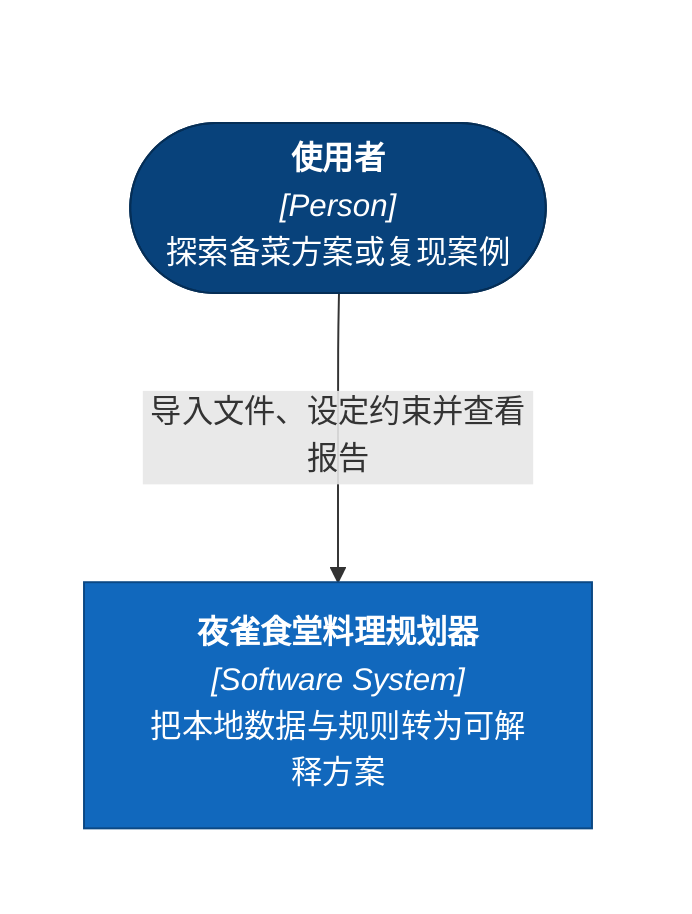
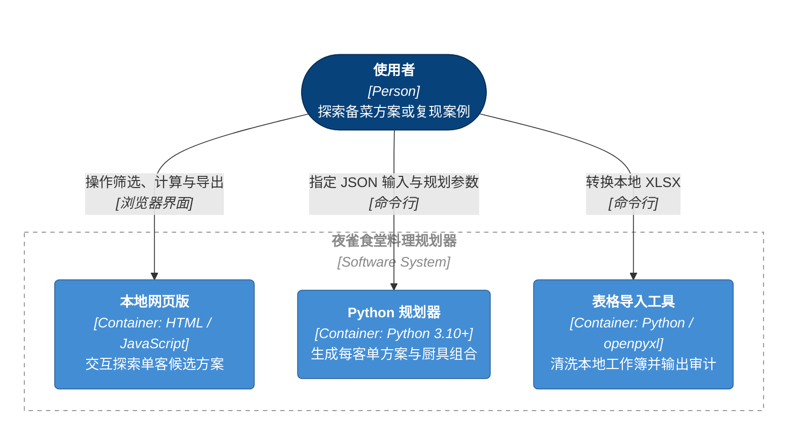
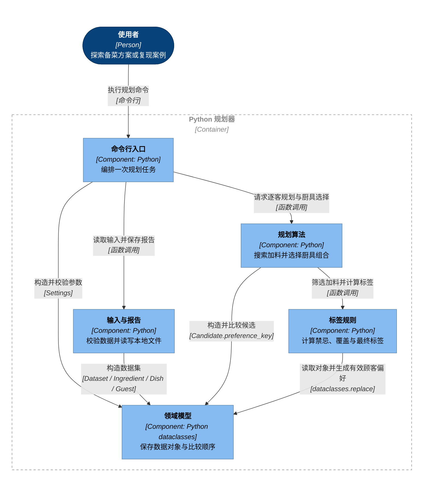

# 架构与规则

本项目把本地游戏资料转成两种决策结果：网页版用于探索一位顾客的候选料理，Python 用于为多位顾客各选一个方案，并比较厨具配置。本页描述当前发布包的实际实现，供阅读作品集、检查规则或继续维护代码的人使用。

系统边界包含本地网页版、Python 规划器和表格导入工具。网页版的计算在浏览器内完成；Python 是使用者另行执行的命令。两者交换的是同一格式的本地数据文件，运行时互不调用。第三方标签资料属于数据来源，详见[来源说明](data-provenance.md)；它不是运行时依赖的在线服务。

| 阅读层次 | 本页回答的问题 |
| --- | --- |
| C4 L1 系统上下文 | 谁使用工具，系统边界在哪里？ |
| C4 L2 运行单元 | 哪些程序可以分别运行，它们如何使用文件？ |
| C4 L3 组件 | 每个程序内部由哪些职责组成，哪些调用有代码依据？ |
| 规则与协议 | 标签、优化目标、输入输出及模型边界如何定义？ |

<details>
<summary>C4 通用图例</summary>

以下图例说明 C4 记号；本项目实际包含的元素以随后四张视图为准。箭头从发起操作的一方指向它依赖或调用的一方，表示依赖方向。返回的数据沿同一次交互传回，不另画成反向依赖。

```mermaid
---
config:
  flowchart:
    subGraphTitleMargin:
      bottom: 30
---
flowchart LR
    person_legend(["`**Name**
*[Person]*
Description`"])
    sys_legend["`**Name**
*[Software System]*
Description`"]
    ctr_legend("`**Name**
*[Container]*
Description`")
    cmp_legend["`**Name**
*[Component]*
Description`"]
    ext_legend["`**Name**
*[External System]*
Description`"]
    ext_legend_store[("`**Name**
*[External Data Store]*
Description`")]
    infra_legend["`**Name**
*[Infrastructure Node]*
Description`"]

    subgraph deploy_legend["`**Parent Name** *[Deployment Node]*`"]
        subgraph deploy_nested_legend["`**Nested Name**
*[Deployment Node]*`"]
            ctr_legend_i("`**Name**
*[Container Instance]*
Description`")
        end
    end

    subgraph bnd_legend["`**Name**
*[Software System]*`"]
        ctr_legend_store[("`**Name**
*[Internal Data Store]*
Description`")]
    end

    %% Layout only: chains the entries into a single row
    person_legend ~~~ sys_legend
    sys_legend ~~~ ctr_legend
    ctr_legend ~~~ cmp_legend
    cmp_legend ~~~ ext_legend
    ext_legend ~~~ ext_legend_store
    ext_legend_store ~~~ infra_legend
    infra_legend ~~~ deploy_legend
    deploy_legend ~~~ bnd_legend

    classDef person fill:#08427b,stroke:#052e56,color:#ffffff
    classDef system fill:#1168bd,stroke:#0b4884,color:#ffffff
    classDef container fill:#438dd5,stroke:#2e6295,color:#ffffff
    classDef component fill:#85bbf0,stroke:#5d82a8,color:#000000
    classDef external fill:#999999,stroke:#6b6b6b,color:#ffffff
    classDef infrastructure fill:#b0c4de,stroke:#7b899b,color:#000000

    class person_legend person
    class sys_legend system
    class ctr_legend,ctr_legend_i,ctr_legend_store container
    class cmp_legend component
    class ext_legend,ext_legend_store external
    class infra_legend infrastructure

    style deploy_legend fill:none,stroke:#2e6295,color:#2e6295
    style deploy_nested_legend fill:none,stroke:#2e6295,color:#2e6295
    style bnd_legend fill:none,stroke:#888888,stroke-dasharray:5 5,color:#888888
```



</details>

## 系统上下文

使用者可以导入自己的资料，也可以直接使用仓库中的虚构样例。模型把导入文件和导出报告视为使用者选择的工件；当前实现没有常驻数据服务。因此 L1 只需要使用者和规划器两个元素，运行细节在下一层展开。



图源：[01-system-context.mmd](diagrams/01-system-context.mmd)。系统图中的使用者同时涵盖实际备菜的人和复现样例的作品集读者。

## 运行单元

这里的 Container 指 C4 中可运行的程序单元。三个入口分别由使用者启动，表格导入工具完成后退出；它生成的 JSON 可在之后的网页或 Python 会话中使用。文件交接不代表程序之间存在 API 调用。



图源：[02-containers.mmd](diagrams/02-containers.mmd)。三个运行单元均属于同一个作品集系统。

| 运行单元 | 入口与运行环境 | 输入 | 输出 |
| --- | --- | --- | --- |
| 本地网页版 | 浏览器打开 [`index.html`](../index.html)，载入本地 JavaScript | 随附样例，或手动选择 XLSX / JSON | 屏幕候选表；下载 CSV / XLSX |
| Python 规划器 | [`tools/run_planner.py`](../tools/run_planner.py) 或 `python -m mystia_planner`；Python 3.10+ | 标准 JSON 与命令行参数 | 每客单方案、厨具组合、JSON / 可选 CSV |
| 表格导入工具 | [`tools/prepare_data.py`](../tools/prepare_data.py)；Python 与 openpyxl | 使用者指定的 XLSX | 标准 JSON 与独立导入审计报告 |

Python 规划器和合成样例只需要标准库。openpyxl 用于一次性的 Excel 转换；网页版通过仓库随附的 [SheetJS](../web/vendor/xlsx.full.min.js) 处理工作簿。可选的 `python -m http.server` 只提供本地静态文件，不承担规划计算。

## Python 组件

一次命令由 `cli.main()` 编排：构造参数、读取数据、调用规划器，最后保存报告。图中的组件对应真实 Python 文件；箭头依据导入关系和函数调用。



图源：[03-python-components.mmd](diagrams/03-python-components.mmd)。

| 组件 | 实现与关键接口 | 职责 |
| --- | --- | --- |
| 命令行入口 | [`cli.py`](../src/mystia_planner/cli.py)：`build_parser()`、`main()` | 接收顾客筛选、厨具数量、排除项、流行标签、阈值与日单量；阻止输入输出路径相同 |
| 输入与报告 | [`io.py`](../src/mystia_planner/io.py)：`load_dataset()`、`dataset_from_dict()`、`write_json_report()`、`write_csv_report()` | 校验行字典；构造数据对象；写出完整报告和简表 |
| 规划算法 | [`planner.py`](../src/mystia_planner/planner.py)：`plan_dataset()`、`best_by_cookware()`、`best_dish_candidate()`、`_allocate_equivalent()` | 枚举合法加料，分配同标签食材，预计算每客每厨具方案，再比较厨具组合 |
| 标签规则 | [`rules.py`](../src/mystia_planner/rules.py)：`effective_guest()`、`allowed_addons()`、`final_tags()`、`score_tags()` | 处理流行状态、配方禁忌、派生与覆盖规则 |
| 领域模型 | [`models.py`](../src/mystia_planner/models.py)：`Dataset`、`Ingredient`、`Dish`、`Guest`、`Settings`、`Candidate` | 保存数据与参数；`Candidate.preference_key` 定义确定性的候选排序 |

`tools/run_planner.py` 只是从仓库直接启动 CLI 的包装。表格导入工具属于前一层独立运行单元，不在规划器内部读取 Excel。旧原型中的“每个喜爱标签一个方案”求解流程没有保留为当前规划入口。

## 网页组件

页面由 [`index.html`](../index.html)、[`web/styles.css`](../web/styles.css) 和 [`web/app.js`](../web/app.js) 组成。下图按逻辑职责拆解 `app.js`；这些方框大多是同一个脚本中的函数、事件回调和状态，并非已经分成多个模块或服务。

```mermaid
---
config:
  flowchart:
    subGraphTitleMargin:
      bottom: 30
---
flowchart TB
    subgraph layout_top[" "]
        person_使用者(["`**使用者**
*[Person]*
探索备菜方案或复现案例`"])
    end
    subgraph layout_center[" "]
        subgraph ctr_本地网页版["`**本地网页版**
*[Container]*`"]
            cmp_浏览器交互入口["`**浏览器交互入口**
*[Component: JavaScript / DOM]*
接收文件、顾客与参数操作`"]
            cmp_数据导入["`**数据导入**
*[Component: JavaScript]*
把样例或文件转为内存数据`"]
            cmp_worker_调度["`**Worker 调度**
*[Component: JavaScript]*
切分料理并管理计算生命周期`"]
            cmp_候选计算["`**候选计算**
*[Component: Web Worker]*
枚举加料并应用选定过滤器`"]
            cmp_结果筛选与显示["`**结果筛选与显示**
*[Component: JavaScript / DOM]*
维护当前筛选结果与表格`"]
            cmp_文件导出["`**文件导出**
*[Component: JavaScript]*
下载当前筛选结果`"]
            cmp_sheetjs["`**SheetJS**
*[Component: bundled JavaScript library]*
读取与写出工作簿`"]
        end
    end

    person_使用者 -->|"`使用页面控件
*[浏览器界面]*`"| cmp_浏览器交互入口
    cmp_浏览器交互入口 -->|"`解析文件或载入样例
*[函数调用]*`"| cmp_数据导入
    cmp_浏览器交互入口 -->|"`提交计算参数或停止任务
*[DOM 事件回调]*`"| cmp_worker_调度
    cmp_浏览器交互入口 -->|"`调整排序与筛选
*[DOM 事件回调]*`"| cmp_结果筛选与显示
    cmp_浏览器交互入口 -->|"`请求下载结果
*[DOM 事件回调]*`"| cmp_文件导出
    cmp_worker_调度 -->|"`启动计算并接收分批结果
*[Web Worker / postMessage]*`"| cmp_候选计算
    cmp_worker_调度 -->|"`汇总完成结果并刷新筛选
*[finishAll / applyFilters]*`"| cmp_结果筛选与显示
    cmp_文件导出 -->|"`读取当前筛选结果
*[共享内存 FILTERED]*`"| cmp_结果筛选与显示
    cmp_数据导入 -->|"`解析工作簿
*[SheetJS API]*`"| cmp_sheetjs
    cmp_文件导出 -->|"`写出工作簿
*[SheetJS API]*`"| cmp_sheetjs

    classDef person fill:#08427b,stroke:#052e56,color:#ffffff
    classDef component fill:#85bbf0,stroke:#5d82a8,color:#000000
    class person_使用者 person
    class cmp_浏览器交互入口,cmp_数据导入,cmp_worker_调度,cmp_候选计算,cmp_结果筛选与显示,cmp_文件导出,cmp_sheetjs component
    style ctr_本地网页版 fill:none,stroke:#888888,stroke-dasharray:5 5,color:#888888
    style layout_top fill:none,stroke:none
    style layout_center fill:none,stroke:none
```



图源：[04-browser-components.mmd](diagrams/04-browser-components.mmd)。Worker 由网页创建，随本次计算启动和结束，属于网页版内部的计算组件。

| 逻辑职责 | `web/app.js` 中的依据 | 行为 |
| --- | --- | --- |
| 数据导入 | `loadDemo()`、`parseJSONData()`、`parseExcel()`、`parseDataSheets()` | 将样例或使用者选择的文件解析到内存；导入失败时保留此前有效数据 |
| 参数与交互 | 顾客选择、标签输入和 `btnRun` / `btnStop` 事件 | 形成单客计算参数；运行时暂时禁用数据导入 |
| Worker 调度 | `makeWorker()`、`postMessage({type: "RUN"})`、`w.onmessage`、`finishAll()`、`stopAll()` | 按料理切分任务；最多创建 8 个 Worker，实际数量受硬件线程数和料理数限制 |
| 候选计算 | `makeWorker()` 内的 `workerSrc`、`genCombRep()`、`applyOverrides()`、过滤与 TDQ 比较 | 枚举可重复加料；应用标签规则及用户选择的等价、进阶、子集、采购推荐过滤 |
| 结果筛选与显示 | `RESULTS`、`FILTERED`、`applyFilters()`、`sortAndRender()`、`renderTable()` | 汇总完成结果，再按当前筛选与排序呈现 |
| 文件导出 | `getExportRows()`、`exportCSV()`、`exportXLSX()`、`downloadBlob()` | 导出当前 `FILTERED` 结果，并遵守导出行数限制 |
| 表格读写库 | `XLSX.read()`、`XLSX.utils`、`XLSX.writeFile()` | 读取本地工作簿，或创建下载用工作簿 |

Worker 代码保存在脚本字符串中，通过 Blob URL 创建。主线程发送数据和参数，接收 `ROWS`、`HEART`、`PHASE`、`PROGRESS`、`DONE` 消息；这些是浏览器内部消息。停止操作直接终止 Worker、作废旧消息并清空未完成结果，避免把部分结果当作完整输出。

## 数据文件与执行流程

| 工件 | 协议或内容 | 使用方式 |
| --- | --- | --- |
| [`data/demo.json`](../data/demo.json) | `mystia-planner-data/v1`，全部为合成资料 | 网页与 Python 的公共演示输入 |
| [`web/demo-data.js`](../web/demo-data.js) | 同一数据赋给 `window.MYSTIA_DEMO_DATA` | 由 [`tools/sync_demo.py`](../tools/sync_demo.py) 同步，让双击页面也能载入样例 |
| 使用者的 XLSX | 四张具名工作表与缓存的单元格值 | 网页直接读取，或交给导入工具清洗 |
| 本地标准 JSON | `format`、`metadata`、`sheets` | 四张表分别保存行字典；规划时按名称读取供给 |
| Python 结果 JSON | `mystia-planner-result/v1` | 保存参数、选定厨具、汇总、逐客方案与模型边界 |
| CSV / 网页 XLSX | 面向阅读的结果表 | 使用者主动导出；完整 Python 信息以 JSON 为准 |

**网页路径。** 页面先解析随附的样例，或通过 File API 读取用户选定文件。点击计算后，把料理分段送入 Worker；所有任务完成后才形成可导出的完整结果。排序、筛选与导出读取同一份当前结果状态。刷新页面会结束内存中的会话。

**Python 路径。** CLI 读取标准 JSON 和参数，验证后执行 `plan_dataset()`。该函数先为每位顾客求各厨具下的最佳候选，再选择共享的厨具集合，最后生成逐客报告。保存 JSON 与 CSV 由 CLI 调用 `io.py` 完成。

**Excel 整理路径。** `prepare_data.py` 使用 `data_only=True` 读取已有公式缓存，保留指定字段并移除图标。食材采购价按 `Name` 匹配商贩表中的 `Average Buy Price`；未知价格保留 `null`。无具体配方、基础食材不明、厨具或售价无效，以及特定不可规划料理会标记 `Owned=0`。源工作簿保持不变，修正与停用原因写入单独的审计报告。该工具不重新计算 Excel 公式；缓存缺失时需要先在表格软件中重算保存。

## 标签与可行性规则

核心规则可对照 [`rules.py`](../src/mystia_planner/rules.py) 与 [`web/app.js`](../web/app.js) 内的 Worker 枚举。两种实现共享以下标签计算顺序：

1. 合并料理固有标签、厨具标签、售价派生标签、追加食材标签。**基础配方食材只计用量，不额外加入其标签。**
2. 售价 `0 < p < 20` 派生“实惠”，`p > 60` 派生“昂贵”；0、20、60 都不会因此获得对应标签。
3. 原配方不足五格、且通过追加食材达到五格时派生“大份”；原生五格不单凭格数自动派生。
4. 应用标签覆盖，再根据覆盖后的标签触发“流行·喜爱 / 流行·厌恶”。
5. 对最终标签计分，重复标签只计一次。Python 进一步硬排除含厌恶标签的方案。

| 存在的强标签 | 被移除的弱标签 |
| --- | --- |
| 肉 | 素 |
| 饱腹 | 下酒 |
| 重油 | 清淡 |
| 大份 | 小巧 |

基础配方与加料合计最多五件，重复食材占重复格并消耗重复供给。配方禁忌仅限制追加食材：能匹配食材名称的条目按名称排除，其余按食材标签排除；“铃仙”不作为普通追加食材。Python 在没有某方向流行锚点时，从顾客喜好和厌恶中移除相应的流行标签。

## Python 目标与搜索

设 `q_i` 为食材 i 的输入日供给，`K` 为每位顾客的预期日订单数，`c_i` 为单份方案中基础配方与追加食材的总用量。候选的最低供给余量为：

```text
supply_margin = min_i(q_i - K × c_i)    （只考察方案实际使用的食材）
```

`K` 默认为 5，最低标签分默认为 3。输入供给来自 `食材merchant_data.Total Daily Quantity`，按食材名称关联。这里的“总食材件数”是格数／数量，不是采购金额。

### 每位顾客的单方案

`best_dish_candidate()` 按完全相同的标签集合对合法追加食材分组，逐层枚举加料件数，保留重复选择。确定每组要用几份以后，`_allocate_equivalent()` 再决定具体成员：把基础配方消耗纳入 `q_i - K × (基础用量 + 加料用量)`，对离散余量阈值做容量可行性二分，并在共同最佳阈值下恢复确定性的食材分配。

| 优先级 | 比较指标 | 方向 |
| --- | --- | --- |
| 1 | 命中喜爱标签数，收益封顶为 3 | 大者优先 |
| 2 | 基础配方与加料的总件数 | 小者优先 |
| 3 | 最低供给余量 | 大者优先 |
| 4 | 料理售价 | 高者优先，仅用于同目标平局 |
| 5 | 料理名、排序后的加料名 | 确定性排序 |

搜索会排除不可覆盖的厌恶标签，使用乐观得分上界跳过不可能达到阈值的配方，并利用已有满覆盖候选限制更长的食材组合。当前件数层全部比较完且覆盖达到 3 后，可以停止更高件数层：额外覆盖已无收益，而更多食材优先级更差。当前 Python 没有 Top-N 候选截断，也没有“中性填充食材仅保留前三种”的限制。

同标签组内供给分配和取消中性填充截断属于本次整理修复，不能追溯为历史原型已经具备的行为。具体反例与修改记录见 [CHANGELOG](../CHANGELOG.md)。

### 共享的厨具集合

`best_by_cookware()` 预计算每客每厨具最佳候选；`plan_dataset()` 枚举可用厨具中的 `n` 元组合。对每个集合，各顾客使用其中适合自己的最佳候选，然后按以下顺序比较组合：

1. 覆盖收益合计最大。
2. 带缺解惩罚的食材件数合计最小。
3. 带缺解惩罚的最低供给余量合计最大。
4. 规范化厨具名次序，保证平局稳定。

每缺一个顾客方案，沿用历史版本增加 `1e9` 件数惩罚、减少 `1e18` 余量。报告将真实合计和比较用惩罚值分开。`--cookware-count n` 选择恰好 n 种可用厨具；平局时集合中可能出现未被最终菜品使用的厨具。省略该参数时使用全部可用厨具。

默认最低分为 3、且厌恶被硬排除，所以所有合格方案的封顶覆盖都是 3；覆盖合计首先推动更多顾客获得方案。最低分改为 1 或 2 后，应按覆盖总量理解，不能等同于顾客人数最多。

## 网页与 Python 的结果为何不同

| 维度 | 本地网页版 | Python 规划器 |
| --- | --- | --- |
| 主要任务 | 单客探索、比较多条候选 | 每客一个方案，比较共享厨具集合 |
| 厌恶处理 | 喜爱命中减厌恶命中，达到阈值可保留 | 命中任一最终厌恶标签即排除 |
| 阈值 | 页面允许 -10 至 10 的整数 | 正整数，默认 3 |
| 候选压缩 | 使用者可开启等价、进阶、子集过滤与采购推荐 | 按标签组搜索，按明确定义的单方案目标比较 |
| 供给指标 | 采购推荐比较升序 TDQ 向量；等价组使用有效平均 TDQ，并保留 Top-N 阈值的并列项 | 比较扣除预期消耗后的 `min(q_i - K × c_i)` |
| 具体等价食材 | 采购推荐与等价去重共同开启时，输出合法组内原始 TDQ 较高的代表 | 在基础耗用和共同余量阈值下分配具体食材 |

网页的过滤器可以收窄候选集，结果不要求与 Python 逐条一致。“依采购推荐”也不代表 Python 的日消耗模型。使用时应先选择要回答的问题，再看相应结果；网页参数详见[操作指南](web-guide.md)。

## 输入输出协议与模型边界

输入版本为 `mystia-planner-data/v1`，顶层包含 `format`、`metadata` 与 `sheets`。四张工作表为 `食材`、`料理`、`稀客`、`食材merchant_data`，各表是保留原字段名的行字典数组。字段示例见 [`data/demo.json`](../data/demo.json)。Python 校验名称唯一、供给有限且非负、已拥有配方的基础食材存在、厨具与售价有效，以及参数取值。网页选择稀客还要求该行 `Type` 为 `rare` 或“稀客”；两个解析器的校验细节并不完全相同。

输出版本为 `mystia-planner-result/v1`。每位选中顾客都有一条 `planned` 或 `no_feasible_plan` 记录，有方案时列出基础配方、加料、最终标签、得分、食材件数、最低余量和各食材余量。`budget_display_only` 标明预算仅作展示；JSON 保存完整结果，CSV 用于简明阅读。

| 边界 | 对结论的影响 |
| --- | --- |
| 各顾客独立计算供给消耗 | 同一种食材在不同顾客方案间没有共同扣减；厨具集合是共享约束，库存不是 |
| 允许负余量 | 指标反映压力，不保证库存足以完成预期订单 |
| 日供给是输入估计 | 不模拟商店刷新随机性或供应波动 |
| 成本指标采用食材件数 | 不优化采购金额、现金利润或委托机会成本 |
| 预算和酒水未进入联合约束 | 方案不等于完整订单满意度或整晚经营方案 |
| 有限组合枚举 | 数据规模和标签组数会影响耗时，未承诺全量数据的固定运行时间 |

独立小规模穷举用于核对搜索结果与规则，不构成完整游戏或联合经营全局最优的证明。测试入口见 [`tests/test_planner.py`](../tests/test_planner.py)、[`tests/test_io_cli.py`](../tests/test_io_cli.py) 与 [`tests/web-regression.cjs`](../tests/web-regression.cjs)；本地已执行的验证范围见[验证记录](verification.md)。

## 图源校验与维护

四张架构视图使用 Mermaid `flowchart TB` 表达 C4 的系统、运行单元与组件层，图例使用规范规定的 `LR`。图中元素首先出现在其所属层级，跨图保持名称与标识符一致；边的方向按发起方到依赖方校核。当前各视图没有需要置于底部的外部运行服务，因此省略空的底部布局带。

- **Source validation：Passed。** 已检查图例一致性、Markdown 标签、元素形状与分类、边界样式、已声明标识符、调用依据及静态层级约束。静态分析中使用者位于 rank 0；上下文和运行单元位于 rank 1，Python 组件位于 rank 1–4，网页组件位于 rank 1–3，均满足上下分带。
- **Mermaid CLI render validation：Not run。** 整理环境未安装 Mermaid CLI，未执行图像渲染与视觉布局验收。Markdown 宿主的实际排版仍取决于其 Mermaid 版本。

图源保存在 [`docs/diagrams/`](diagrams/) 并与本页代码块保持一致。新增程序依赖、文件协议或调用关系时，应同时更新对应视图和职责表。本仓库的 [GitHub workflow](../.github/workflows/checks.yml) 只执行回归与复现检查，本页不据此推导部署拓扑。

本页应用 [Microsoft hve-core 的 C4 Architecture skill](https://github.com/microsoft/hve-core/blob/main/.github/skills/hve-core/c4-architecture/SKILL.md)；通用图例原样沿用其 [Mermaid renderer 参考](https://github.com/microsoft/hve-core/blob/main/.github/skills/hve-core/c4-architecture/references/renderer-mermaid.md)。该参考声明采用 CC-BY-4.0 AND MIT，具体归属见其许可说明。C4 层次与记号基于 Simon Brown 的 [C4 Model](https://c4model.com/)（[CC BY 4.0](https://creativecommons.org/licenses/by/4.0/)），Mermaid 语法参考其 [flowchart 文档](https://mermaid.js.org/syntax/flowchart.html)。项目边界、组件职责和关系依据本仓库代码重新绘制；这些来源说明不代表整个项目采用上述许可。
